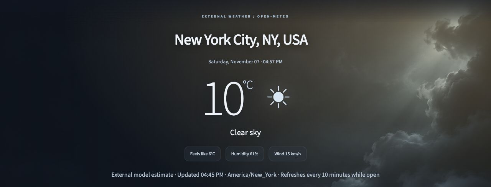
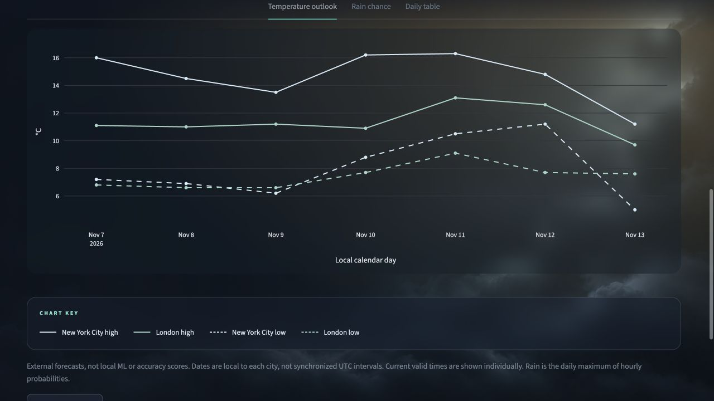

# Forecast.exe

*Decoding the Skies, One Prediction at a Time.*

Forecast.exe is a cinematic, dark-mode weather app and model-evaluation studio built with Python and Streamlit. It trains local machine-learning models on historical weather data to predict daily high and low temperatures and the probability of measurable precipitation for the next seven days. Forecast.exe is experimental and is not intended for safety-critical decisions.

## Forecast.exe Preview

*Screenshots show actual app output captured on November 7, 2026. Weather values change over time.*

For installation, launch commands, methodology, and limitations, see [START_HERE.md](START_HERE.md).

## 💫 Key Features

- **Live weather:** Current estimates and seven-day external forecasts, with optional location detection and remembered cities.
- **City comparison:** Compare weather for two to four cities with clear source labels and local timezones.
- **Local machine learning:** Train city-specific models for daily high, low, and rain probability across seven days.
- **Transparent evaluation:** Compare models with simple baselines using chronological tests, uncertainty intervals, and saved experiments.
- **Historical exploration:** Explore validated weather history and export forecasts, comparisons, and results.
- **Cinematic dark design:** Weather-responsive backgrounds, centered navigation, and accessible header controls.

## ⚙️ Tech Stack

- **Python 3.11+:** Powers data ingestion, feature engineering, training, evaluation, and inference. The project is organized as an installable Python package with separate UI, modeling, evaluation, and experiment modules.
- **Streamlit:** Provides the interactive application, location controls, a weather-first view, training actions, and data exploration pages. The interface uses a dark theme with the theme selector removed.
- **pandas:** Organizes daily weather observations, aligns local-calendar dates, and builds lagged and rolling features. It also prepares seasonal diagnostics, experiment comparisons, and CSV exports.
- **NumPy:** Handles numerical calculations, seasonal encodings, residual quantiles, and deterministic synthetic data generation.
- **scikit-learn:** Supplies histogram gradient boosting regressors and classifiers for the seven forecast horizons. A separate sigmoid calibrator adjusts rain probabilities, while metrics support chronological and rolling evaluation.
- **Plotly:** Renders interactive temperature forecasts, uncertainty bands, baseline comparisons, and reliability charts.
- **HTTPX:** Retrieves historical weather, geocoding results, and optional current external forecasts. Requests use bounded timeouts and retry handling.
- **Apache Arrow / PyArrow:** Supports Parquet storage for raw and normalized weather datasets. Incremental location caches reuse overlapping date windows and retain valid data when updates fail.
- **joblib:** Saves locally generated models and experiment results for reuse. Only trusted local artifacts should be loaded.
- **Open-Meteo APIs:** Supply historical weather and geocoding data, plus an optional external forecast comparison. Historical reference data includes reanalysis estimates and is attributed to Open-Meteo under CC BY 4.0; usage conditions are described in the setup guide.
- **pytest:** Runs offline tests for feature leakage, split isolation, reproducibility, data validation, API failure handling, forecasting, and application startup.
- **Ruff:** Checks Python code for lint errors and provides consistent formatting.
- **GitHub Actions:** Runs lint and offline tests on pushes and pull requests using the included CI workflow.
- **setuptools and pip:** Package and install the project and its dependencies through `pyproject.toml`, including an editable development installation.
- **Browser JavaScript APIs:** A Streamlit component requests location only after a user click and stores only the selected city preference in localStorage. Permission denial and unavailable storage preserve the manual workflow.
- **reverse_geocoder:** Uses an offline GeoNames city index to resolve a nearby city and administrative region. Device positions are converted to city-center locations for weather requests.
- **tzfpy and pycountry:** Resolve a city center's timezone and readable country name without a reverse-geocoding API. Geographic approximations can be corrected through manual city search.

## 💃🏾 Contact

- **LinkedIn:** [linkedin.com/in/cyristalj](https://www.linkedin.com/in/cyristalj)
- **GitHub:** [github.com/cyristal-gems](https://github.com/cyristal-gems)
- **Email:** [cyrisjoseph@outlook.com](mailto:cyrisjoseph@outlook.com)

## License

Original project code is licensed under the [MIT License](LICENSE). Copyright (c) 2026 Cyristal N. Joseph. Third-party libraries and weather/geographic data retain their own licenses and terms; see [attribution and visual design](START_HERE.md#attribution-and-visual-design).
